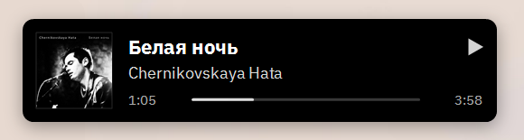
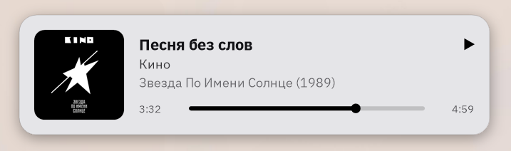
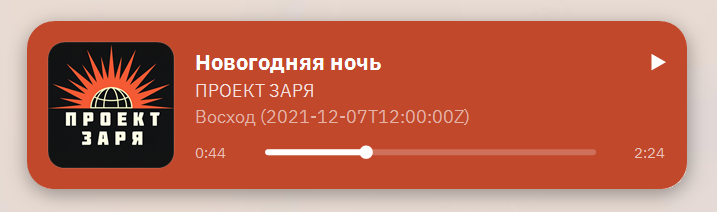
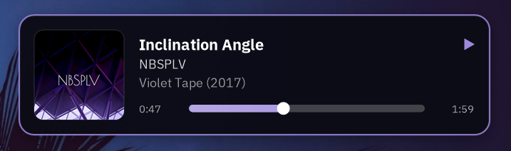

<h1 align="center">On-Screen Display (foo_onscreendisplay)</h1>

<p align="center">
  A modern on-screen display for <a href="https://www.foobar2000.org/">foobar2000</a> v2: a small
  card with the cover, the track and its progress when a song starts.
</p>

<table>
  <tr>
    <td width="50%" align="center"><br /><sub><b>Midnight</b>: compact black card (default)</sub></td>
    <td width="50%" align="center"><br /><sub><b>Snow</b>: light card</sub></td>
  </tr>
  <tr>
    <td width="50%" align="center"><br /><sub><b>Cover colour</b>: the card takes the cover's colour</sub></td>
    <td width="50%" align="center"><br /><sub>Accent from the cover: outline and bar</sub></td>
  </tr>
</table>

## Features

- **31 presets** in four layouts (Classic, Compact, Banner, Poster), or your own look. Save your
  looks as presets of your own.
- **Accent from the cover** for the progress bar and outline, kept readable on the card.
- **Your text**: three lines in title formatting.
- **Your fonts**: one for line 1, one for lines 2-3, and up to three fallback fonts for characters
  they lack (CJK, symbols, emoji). By default they follow your Columns UI or Default UI font.
- **Crisp text**, with ClearType on opaque cards.
- **Nine positions**, on foobar2000's monitor, the primary one or the one under the pointer, with
  per-monitor DPI.
- **Stays out of the way**: click-through, never takes focus, fades while the pointer is over it,
  and can stay away from full-screen apps or show only while foobar2000 is in the background.
- **No jumping**: a new track's card waits briefly for its cover.
- **Internet radio**: shows stream title changes.
- **Light on resources**: nothing runs while the card is hidden.

## Install

Requires foobar2000 v2 on Windows, 32-bit or 64-bit (the package contains both).

1. Download `foo_onscreendisplay.fb2k-component` from the
   [latest release](https://github.com/HongYue1/foo_onscreendisplay/releases/latest).
2. Double-click it, or in foobar2000 open **Preferences > Components > Install...**, and restart.

Settings are in **Preferences > Tools > On-screen display**. **Preview** shows the card with the
values on the page before you press Apply.

**Upgrading from 1.2.0 or older:** this component used to be called `foo_osd`. Remove `foo_osd` in
**Preferences > Components** first; the two must not be installed together. Your settings carry
over.

## Good to know

- **When it shows**: when a track starts, when a stream title changes, on pause and resume, and on
  seek if you turn it on. It can stay up while paused, and the time label can show the time left.
- **Menu**: **View > On-screen display** has *Show now*, *Hide* and *Enabled*. Give them shortcuts
  in **Preferences > Keyboard Shortcuts**.
- **Presets only set the look**, never your fonts, size, position, behaviour or text. Change
  something by hand and the preset box says *Custom*; set it back and the name returns. **Save...**
  and **Delete** take effect at once, without Apply.
- **Default text** is the title, the artist, and the album with its year:

  ```
  $if2(%title%,%filename%)
  %artist%
  %album%[ '('%date%')']
  ```

  An empty line is left out. Literal brackets need quotes: `'('%date%')'`. **Default** on the Text
  tab restores only these lines.
- **Fonts**: line 1 is 11 pt bold and lines 2-3 are 9 pt by default. A fallback font lends only its
  family; size and style come from the line.
- **Sharper text** uses ClearType only when the card is fully opaque and Windows uses ClearType;
  otherwise text is greyscale.

## Building

Visual Studio 2022 or later with the C++ desktop workload and ATL, next to these folders:
`SDK-2026-09-17` (foobar2000 SDK, with the Columns UI SDK inside as `columns_ui-sdk`), `wtl`
(WTL 10) and [`fb2k-common`](https://github.com/HongYue1/fb2k-common).

- `build.bat [Release|Debug] [x64|Win32]` builds the DLL.
- `test\build_render_test.bat` and `test\build_dialog_check.bat` run the tests (no foobar2000
  needed).
- `package.bat` builds both platforms into `dist\foo_onscreendisplay.fb2k-component` (needs 7-Zip).

The Visual Studio and 7-Zip paths are at the top of the batch files.

## See also

My other components:

- [foo_enhancedplaylisttabs](https://github.com/HongYue1/foo_enhancedplaylisttabs): fast,
  customisable playlist tabs.
- [foo_bettertabs](https://github.com/HongYue1/foo_bettertabs): a tab container for panels and
  elements.
- [foo_filetree](https://github.com/HongYue1/foo_filetree): a folder tree panel.

## License

[MIT](LICENSE)
